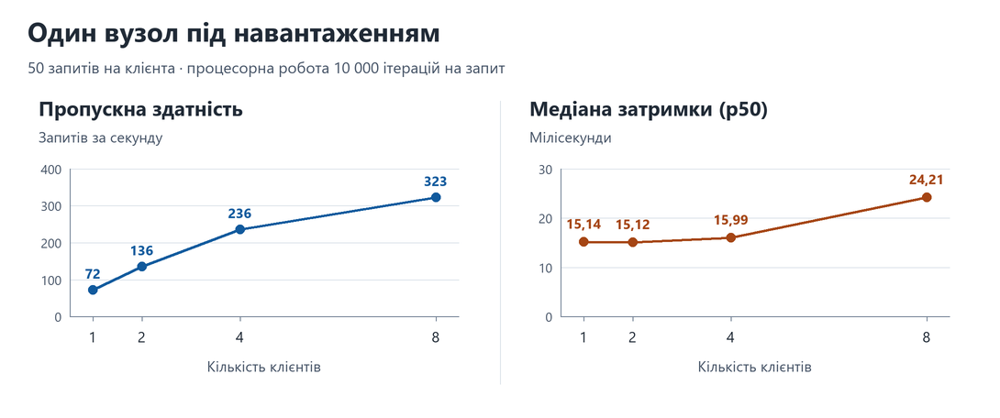

# Практична 09. Архітектури в числах

**Білик Богдан Вікторович, 416-пр. 22.11.2026.**

## Умови замірів

Стенд викладача запущено локально на `127.0.0.1` під Windows 11 на AMD Ryzen 9 9950X3D із CPython 3.14.0 та увімкненим GIL. В усіх копіях служби задано `--robota-cpu 10000`. Служби й журнали перезапускали перед незалежними прогонами. Для кожної конфігурації без відмови в кроках 1, 2 і 4 виконано по три прогони. Наведено результат найшвидшого, а медіану й p95 узято з того самого прогону. Сценарії відмови виконано окремо. Запуски та вимірювання на ПК студента виконано за допомогою Codex. [Команди відтворення](README.md)

## Один вузол під навантаженням

У базовому прогоні один клієнт надіслав 200 запитів. Служба A обробила всі 200 за 2,89 с, тобто **69 запитів/с** із медіаною **15,35 мс**. Після прогону в журналі A було 200 записів.

У серії для кривих кожен клієнт надсилав по 50 запитів. Помилок не було.

| Клієнтів | Запитів | Запитів/с | Медіана, мс | p95, мс | Записів у A |
|---:|---:|---:|---:|---:|---:|
| 1 | 50 | 72 | 15,14 | 27,04 | 50 |
| 2 | 100 | 136 | 15,12 | 29,72 | 100 |
| 4 | 200 | 236 | 15,99 | 30,95 | 200 |
| 8 | 400 | 323 | 24,21 | 30,67 | 400 |

Перехід від 4 до 8 клієнтів додав **37%** пропускної здатності, а медіана затримки зросла з **15,99 до 24,21 мс**. Потоки одного процесу ділять GIL під час обчислення коротких хешів, тому додаткові запити дедалі довше чекають на процесорну роботу.

## Чотири конфігурації

| Конфігурація, 8 клієнтів | Успішні / усі | Запитів/с | Медіана, мс | Записів після прогону | Де зберігаються дані та що обмежує швидкість |
|---|---:|---:|---:|---|---|
| Одна копія A | 400 / 400 | 323 | 24,21 | A: 400 | Журнал у пам’яті A. Обчислення обмежені GIL одного процесу. |
| A і B за балансувальником, окремі журнали | 400 / 400 | 370 | 21,06 | A: 200, B: 200 | Кожен процес тримає свою частину журналу. Обчислення розподілені на дві копії, а кожне з’єднання проходить через проксі. |
| Та сама схема, B вимкнено під час прогону | 1588 / 1600 | 234 | 23,99 | A: 1222, B: недоступний | Дані A лишилися в його пам’яті, журнал B зник. Після виключення B усі нові обчислення йдуть через A. |
| A і B без стану, одне спільне сховище | 400 / 400 | 284 | 26,86 | A: 400, B: 400, сховище: 400 | A і B читають один журнал. Запис потребує додаткового TCP-з’єднання, а журнал має один процес і спільний замок. |

Друга копія з окремим журналом підвищила пропускну здатність із 323 до 370 запитів/с, приблизно на **15%**. Балансувальник розділив запити порівну. Кожен журнал показав число 200, хоча система прийняла 400 записів. Це дві окремі половини даних.

Спільний журнал знизив пропускну здатність із 370 до 284 запитів/с, приблизно на **23%**. Обидві копії обслужили по 200 запитів і після прогону бачили всі 400 записів у сховищі.

## Відмова під час роботи

**Копія B із власним журналом.** Її процес зупинено через 2,00 с від початку довгого прогону з 1600 запитами. Балансувальник виключив B через 0,544 с. За весь прогін було 12 помилок. A підтвердила 1222 записи, B встигла підтвердити 366. Після зупинки B доступними залишилися 1222 записи в A. Підтверджені копією B 366 записів втрачено разом із її журналом у пам’яті.

**Порівняння перевірки живості.** Коли B вже була вимкнена, чотири клієнти надіслали по 25 запитів. З перевіркою живості A обробила **100 із 100 за 0,54 с**. У режимі `--bez-perevirky` A обробила **50 із 100 за 28,29 с**, а решту запитів балансувальник намагався переслати на B. За відмови перевірка живості зберігає доступ до робочої копії для всіх нових запитів після виключення недоступної.

**Копія B зі спільним журналом.** Після зупинки B балансувальник виключив її за 0,976 с. A обробила ще 40 із 40 запитів, і в спільному журналі стало 440 записів. Усі 400 попередніх записів залишилися доступними.

**Спільне сховище.** Після зупинки сховища, коли обидві копії A і B були запущені, вісім клієнтів надіслали 40 запитів. За 2,08 с отримано **0 успішних записів і 40 помилок з’єднання**. Балансувальник виключив обидві копії. На прямий запит запису A і B відповіли `status: pomylka` через недоступне сховище.

## Вибір для сценарію A

Для щоденного піка з 10 000 показань квартирних лічильників обираю дві копії без стану зі спільним журналом. Дві незалежні копії дали вищу швидкість, **370 проти 284 запитів/с**, але залишили дані в окремих журналах. Спільний журнал зберіг усі 400 записів після зупинки копії B.

Робочий орієнтир для цього сценарію — прийняти 10 000 записів за 120 с, тобто в середньому щонайменше 83,3 запису/с. За локальних **284 записів/с** така кількість відповідала б приблизно **35 с**. Це оцінка за локальним заміром на 400 запитах.

Єдина точка відмови журналу — спільне сховище. Один балансувальник також є єдиною точкою входу. Якщо вимога зміниться на **нуль втрачених підтверджених записів навіть після відмови процесу сховища**, перейду на сховище зі стійким записом і реплікою. Підтвердження клієнту видаватиметься після фіксації запису.

Найбільше здивували **366 підтверджених записів**, що зникли після зупинки B. Успішна відповідь від копії показує, що вона прийняла запис, а збереження після її відмови залежить від того, де розміщено журнал.
